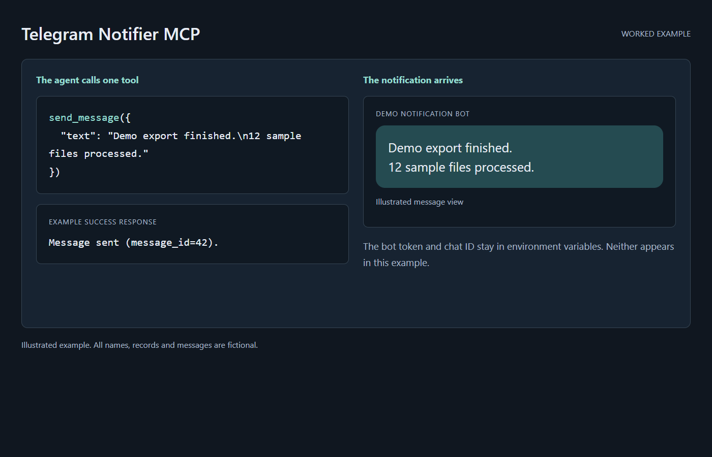

# telegram-notifier-mcp



A minimal MCP (Model Context Protocol) server that gives an AI agent one tool: `send_message(text, parse_mode?)`, which posts a message to a Telegram chat via a bot. Useful for "notify me when the long job finishes" workflows from Claude Code, Claude Desktop, or another client with compatible stdio MCP support.

No database, no state, one dependency surface: the server reads `BOT_TOKEN` and `CHAT_ID` from the environment and calls the Telegram Bot API.

## Start here

This is an MCP server you register with your agent, not a skill. You need Node.js 18 or newer, npm, a Telegram account and bot, and a client that can launch a local stdio MCP server. Download or clone this repo and run Setup from its root; keep the bot token in private configuration.

After registration, ask your agent: "Confirm that the telegram-notifier send_message tool is available. Show me the configured destination, without exposing the token, and wait for permission before sending a test message." After you approve the test, success is the message appearing in that chat. Merely installing the server sends nothing. Another client needs compatible stdio MCP support; a hosted session needs an explicit bridge or a separate HTTPS integration.

## Setup

1. Create a bot with [@BotFather](https://t.me/BotFather) and copy the HTTP API token (format `123456789:AAxxxx...`).
2. Get your chat ID: message your bot once, then visit `https://api.telegram.org/bot<TOKEN>/getUpdates` and read `message.chat.id`.
3. Install dependencies: `npm install`.

## Use with Claude Code / any MCP client

Register as a stdio MCP server:

```json
{
  "mcpServers": {
    "telegram-notifier": {
      "command": "node",
      "args": ["path/to/server/index.js"],
      "env": { "BOT_TOKEN": "<your bot token>", "CHAT_ID": "<your chat id>" }
    }
  }
}
```

The `manifest.json` also makes this packageable as an MCPB desktop extension, with the token and chat ID collected as user config at install time.

## Where it can run

This is a **local stdio server**: a compatible client on that machine must register and launch it. A **cloud/hosted scheduled run cannot directly spawn this server on your PC**; it needs an explicitly configured connection to that machine. Another option is to call the Telegram Bot API over HTTPS (`https://api.telegram.org/bot<TOKEN>/sendMessage`) from the hosted environment with its own private credentials. The server is a thin wrapper around that endpoint.

## Help

For setup questions or errors, [open an issue](https://github.com/dtiger1889-ops/telegram-notifier-mcp/issues) with the relevant versions and a redacted error description.

## License

MIT. See [LICENSE](LICENSE).
